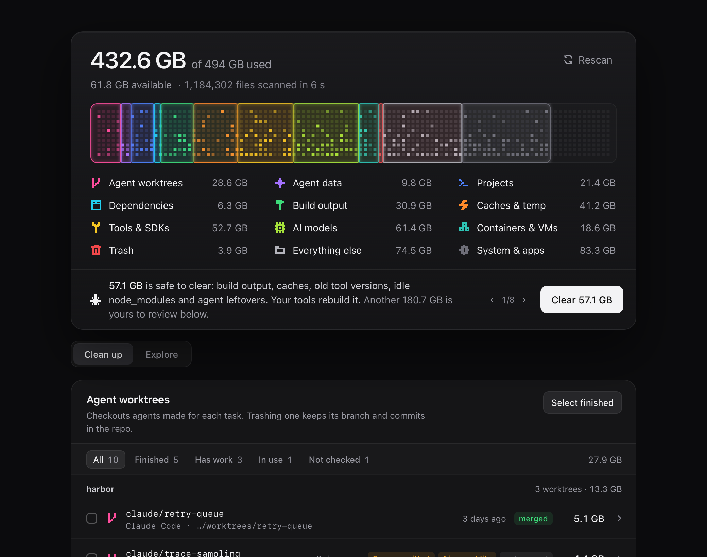
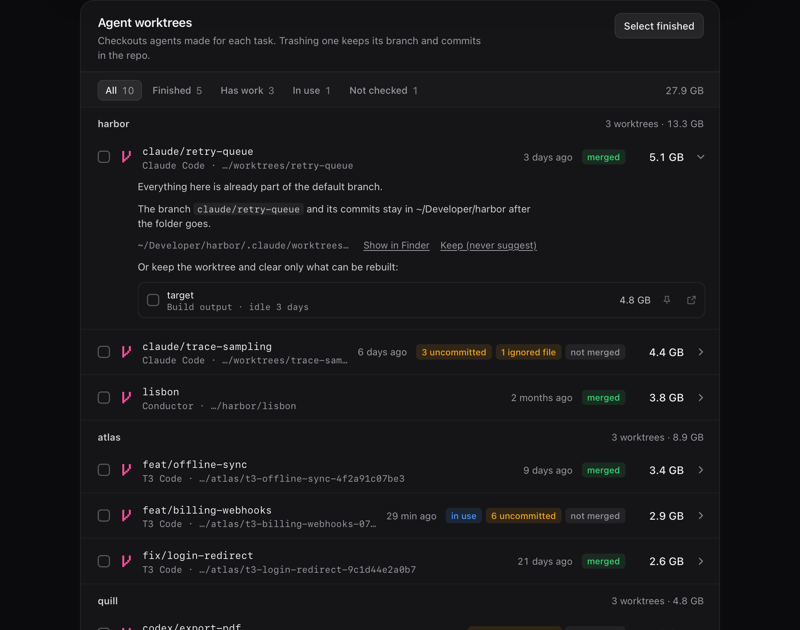
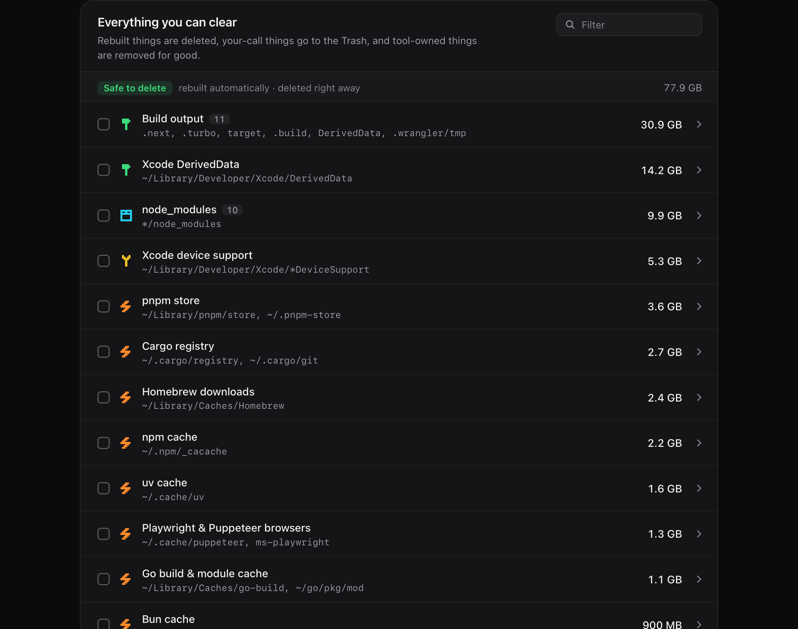
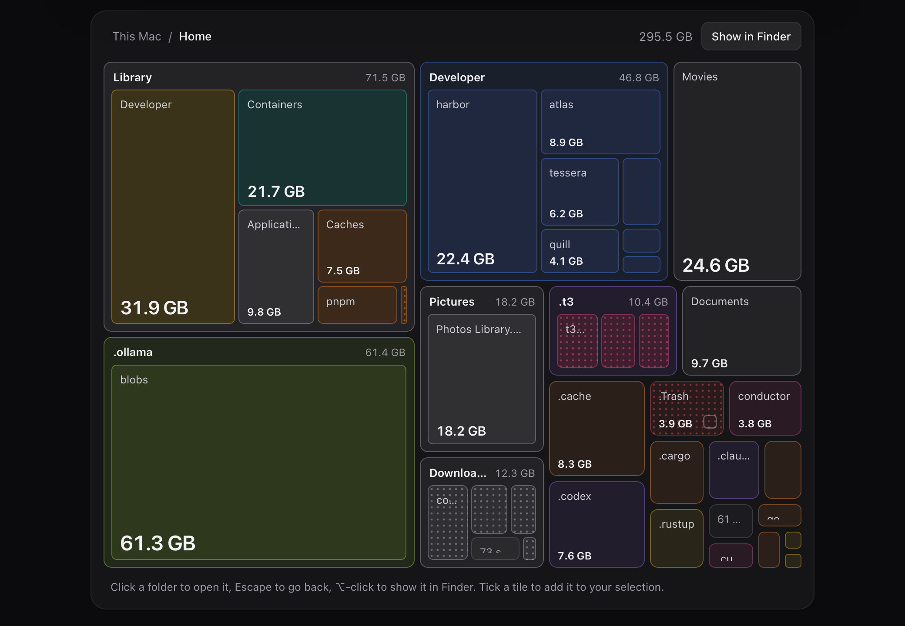
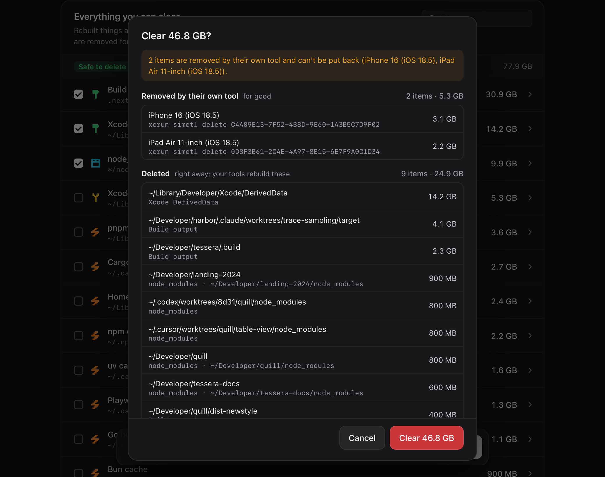

# Storage

A macOS app that shows where a developer's disk went and clears what can safely go, with special care for
the git worktrees that coding agents leave behind.



Coding agents (T3 Code, Claude Code, Codex, Conductor, Cursor) make a fresh checkout for every task, each
with its own `node_modules` and build output. A few weeks of that fills a disk, and the usual cleaners
neither know what a worktree is nor whether it still holds work. Storage scans your home folder and the
developer folders outside it in a few seconds, sorts every byte into a category, and tells you what is
finished, what can be rebuilt and what is yours to decide.

The screenshots here show made-up data.

## What it finds

### Agent worktrees

Every worktree is inspected with git before it is offered: its branch, uncommitted and untracked files,
commits that exist nowhere else, ignored files that can't be regenerated (a `.env`), whether it has been
merged or its pull request squash-merged, and whether anything is running in it right now. "Select
finished" picks only the ones where git answered and nothing would be lost.



If you'd rather keep a worktree, you can clear only its build output and dependencies.

### Everything else a developer accumulates

Build output (`target`, `.next`, `.build`, DerivedData), `node_modules` and virtualenvs, package manager
caches (npm, pnpm, Yarn, Bun, Cargo, Go, uv, pip, Gradle, Homebrew, CocoaPods), Xcode device support,
simulators and their runtimes, old toolchain versions, Docker's unused images, Ollama and LM Studio models,
agent transcripts and caches, app caches, old downloads and installers, and the Trash.



### The whole disk

The Explore tab is a treemap of everything that was scanned. Click into folders, and tick any tile that
Storage knows how to clear to add it to your selection.



## How things are removed

There are three ways out, and the list is grouped by them:

- **Deleted right away**: only what a named tool rebuilds on its own, such as build output and package
  caches.
- **Moved to the Trash**: anything that is your call, so it can be put back. That includes worktrees, app
  caches, logs, downloads and toolchains.
- **Removed by its own tool**: simulators, Docker data and local models are removed by `simctl`, Docker and
  Ollama, which can't be undone.

Nothing is cleared without a confirmation that names every item and every risk.



### What it won't do

- **Act on something you weren't shown.** A scan can be hours old, so everything is checked again at the
  moment it is cleared. A worktree with a new commit, a changed file or a process now running in it is left
  alone, as is a cache whose app has since been started, or a stale folder that has been written to.
- **Treat "git didn't answer" as "clean".** A worktree that couldn't be fully inspected is shown as not
  checked and is never selected for you.
- **Lose commits or staged work.** Before a worktree goes to the Trash, commits on a detached HEAD and
  anything staged are saved under `refs/storage/trashed/` in the repository. Branches are never touched.
- **Sweep up things in use.** Caches of running apps, the default Rust, Node or Python version and a booted
  simulator are held back, and worktrees touched in the last two hours are not suggested.
- **Follow a symlink**, leave your home folder for anywhere but a few known temp and cache locations, or
  touch a file it doesn't own.

Every cleared item is written to `~/Library/Logs/Storage/cleanup.log`.

## Install

There are no prebuilt releases yet, so build it from source. You need macOS 13.3 or later, the Xcode
Command Line Tools and a recent stable [Rust](https://rustup.rs).

```sh
git clone https://github.com/eyeb0l/storage.git
cd storage
cargo run -p storage-app                      # run a debug build
npx @tauri-apps/cli@2 build --bundles app     # or build Storage.app into target/release/bundle/macos/
```

On first launch Storage explains how to grant it Full Disk Access: it opens the right pane of System Settings
with a small panel beside it, and dragging Storage from the panel into the list adds it. Without that, macOS
hides the Trash and other apps' data, so those are reported as unreadable rather than measured. Empty Trash then deletes only
what Storage itself moved there; empty the rest from Finder. macOS ties the permission to the app's
signature, so a locally built, ad-hoc signed copy loses it each time it is rebuilt and has to be granted again.

### From the terminal

The scanner is a plain Rust crate with no dependency on the app, and comes with a read-only command:

```sh
cargo run --release -p storage-core --example scan            # a summary
cargo run --release -p storage-core --example scan -- --json  # the full report
```

## Development

| Path | What it is |
| --- | --- |
| `crates/storage-core` | Everything that touches the disk: the scanner, the rules, git inspection and cleanup. |
| `src-tauri` | A thin [Tauri](https://tauri.app) shell that exposes the core to the window. |
| `ui` | The interface in plain JavaScript and CSS, with no build step. |

```sh
cargo test -p storage-core                  # unit tests and end-to-end tests against a fake home folder
cargo clippy --workspace --all-targets
cargo fmt --all
```

The end-to-end tests build real git repositories and worktrees inside a temporary folder and never read or
clear anything outside it. `CLAUDE.md` describes the architecture in detail.

## Licence

[MIT](LICENSE)
